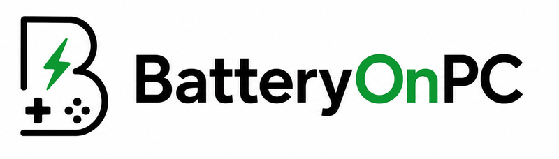

  <a href="https://batteryonpc.com">
    <picture>
      <source media="(prefers-color-scheme: dark)" srcset="assets/logo-dark.png">
      
    </picture>
  </a>

<h3 align="center">Your controller, mouse, keyboard and headset battery, always in the Windows taskbar.</h3>

  <a href="https://batteryonpc.com"><b>Website</b></a> ·
  <a href="https://batteryonpc.com/compatibility">Compatible devices</a> ·
  <a href="https://batteryonpc.com/faq">FAQ</a> ·
  <a href="../../issues/new/choose">Request a device</a> ·
  <a href="CHANGELOG.md">Changelog</a>

<!-- Screenshot to add: assets/screenshot.png (taskbar icons and a low battery notification), then remove these comment marks:

-->

BatteryOnPC is a small Windows 10 and 11 app that keeps the battery level of your game controllers, mice, keyboards and headsets in the taskbar, with one icon per device, and warns you before a battery dies.

Windows shows no battery level at all for PlayStation and Nintendo controllers, and shows the Xbox controller's level only in places you have to open (Settings, the Xbox Accessories app, the Game Bar). Steam shows it only while Steam is running. BatteryOnPC keeps it in view, whatever you are playing.

Mice, keyboards and headsets have a different problem: their battery usually lives inside each brand's software (Logitech G HUB, Razer Synapse, Corsair iCUE, SteelSeries GG), which runs all day just to show a percentage. BatteryOnPC reads many of them directly, so all your batteries sit side by side, with one color code and one set of alerts.

> This repository is the public home of BatteryOnPC: documentation, changelog, device requests and bug reports. The app itself is closed source.

## What's new

- **2.0.10, devices that were misread are fixed.** The GameSir Cyclone 2, which Windows sees as a wired controller without a battery, now shows its real level. The MCHOSE X9 headset no longer beeps every few seconds. VXE and Pulsar mice are read, and the first-generation DualShock 4 is recognized.
- **2.0.9, the window fits every screen.** With high Windows scaling (a 4K display at 300%, a laptop at 150%), the window could open partly off screen. It now always opens inside the usable area of the screen under your mouse.

Updates install automatically. Full history in the [changelog](CHANGELOG.md).

## Features

- **One taskbar icon per device**, tinted by level: green from 50%, orange from 25%, red below 25%. Grey when the device is off or out of range, a "?" when it is detected but does not report its battery.
- **Notifications** at the threshold you choose (5 to 50%, set per device), on connection and disconnection, an optional reminder while the battery stays low, and "fully charged" once per real charge.
- **Headsets, mice and keyboards next to your controller** (beta): Logitech, Razer, Corsair, SteelSeries, HyperX, Astro, Sony INZONE, Audeze and more, each with its own icon and its own alert threshold.
- **No vendor suite needed** to see those batteries: G HUB, Synapse, iCUE or SteelSeries GG can stay closed for the devices BatteryOnPC reads.
- **Runtime estimate** for PlayStation and Nintendo controllers.
- **Passive reading** for PlayStation, Xbox and Nintendo controllers: the app never sends them a command, so no input lag and no game losing the controller mid-match.
- **Works alongside Steam and DS4Windows.**
- **Several controllers at once**, each with its own icon ([how to add a second one](https://batteryonpc.com/guides/track-a-second-controller)).
- **DualSense mute button**: it can mute and unmute your PC microphone (off by default).
- **8 languages**: English, French, Spanish, German, Arabic, Russian, Chinese, Japanese.
- **Automatic updates.**

## Supported devices

Over 200 models, all read through public protocols. The up-to-date list is on [batteryonpc.com/compatibility](https://batteryonpc.com/compatibility).

### Controllers

Detected automatically:

| Brand | Models | Battery level |
|---|---|---|
| Sony | DualSense, DualSense Edge, DualShock 4, DualShock 4 (V2), DualShock 4 USB wireless adaptor. Over USB, Bluetooth or the adaptor | Percentage |
| Microsoft | Xbox Series X\|S, Xbox One, Xbox Elite Series 2, Xbox Elite, Xbox 360 (wireless receiver), third-party XInput controllers that report their level (PowerA, PDP…). Up to 4 at once | 4 steps: empty, low, medium, full |
| Nintendo | Switch Pro Controller, Joy-Con (L), Joy-Con (R), SNES, N64 and Sega Genesis controllers (Switch Online) | Coarse steps: full, medium, low, critical |
| GameSir | Cyclone 2, on its 2.4 GHz dongle (Windows sees it as a wired Xbox controller; the level comes from the dongle) | Percentage |

Added once from the app's Devices tab:

| Brand | Models |
|---|---|
| Valve | Steam Controller (2015 and 2026), over USB or its wireless Puck |
| 8BitDo | SF30 Pro, SN30 Pro, Pro 2, Pro 3, Ultimate 2 Wireless, Ultimate 3, in D mode |
| Flydigi | Apex 5, Vader 5 Pro, Apex 6, Apex 6 Pro |

- **Xbox:** XInput, the Windows route for Xbox controllers, only reports four steps, so every XInput tool shows the same four. Over Bluetooth, Windows Settings shows a finer percentage.
- **Nintendo:** these controllers include their level in their reports only once a program such as Steam has switched them to full mode. Before that, they appear with a "?".

### Mice, keyboards and headsets (beta)

| Type | Brands |
|---|---|
| Headsets (50+) | Logitech G, Astro, Razer, Corsair, SteelSeries, HyperX, Sony INZONE, Audeze, MCHOSE, and office headsets from Lenovo, Jabra and Poly |
| Mice (80+) | Logitech (G and MX series), Razer, SteelSeries, Corsair, ATK, VXE, Kysona, Pulsar and WLMOUSE |
| Keyboards (30+) | Logitech (G and MX series), Razer and Corsair |
| Anything else | Any device that reports its battery over standard Bluetooth or HID |

They are read through public protocols, model by model. Add them from the app: right-click the taskbar icon, then **Add a device (beta)**, or use **Scan for devices** in the Devices tab. Each one gets its own taskbar icon, with the same color code and the same alerts as your controller.

<b>Headsets</b>

- **Logitech G** (receiver): G733 Lightspeed, G935, G933, G533, G535 Lightspeed, PRO X Wireless, PRO X 2 Lightspeed, G522 Lightspeed
- **Astro** (base station): A50 (Gen 5)
- **Razer** (receiver): Nari
- **Corsair** (receiver): Void Wireless, Void Pro Wireless, Void RGB Elite Wireless, HS70 Wireless, HS70 Pro Wireless, Virtuoso RGB Wireless XT, Virtuoso RGB Wireless SE, Void Wireless V2, Virtuoso Max Wireless, HS80 Max Wireless
- **SteelSeries** (receiver): Arctis 1 Wireless, Arctis 1 Wireless (Xbox), Arctis 7, Arctis 7 (2019), Arctis 7P, Arctis 7X, Arctis 9, Arctis Pro Wireless, Arctis 7+, Arctis 7P+, Arctis 7X+, Arctis Nova 7, Arctis Nova 7X, Arctis Nova 7P, Arctis Nova 7 Gen 2, Arctis Nova 5, Arctis Nova 5X, Arctis Nova 3P Wireless, Arctis Nova 3X Wireless, Arctis Nova Pro Wireless, Arctis Nova Pro Wireless (Xbox), Arctis GameBuds
- **HyperX** (receiver): Cloud II Wireless, Cloud Alpha Wireless, Cloud Flight
- **Sony INZONE** (receiver): INZONE H5, INZONE Buds
- **Audeze** (receiver): Maxwell (PlayStation), Maxwell (Xbox), Maxwell 2 (PlayStation), Maxwell 2 (Xbox)
- **MCHOSE** (receiver): X9 Wireless
- **Office** (USB or Bluetooth): Lenovo Wireless VoIP, Jabra Evolve2 (Link 390), Jabra Evolve2 65 Flex, Poly Voyager 8200 UC

<b>Mice</b>

- **Logitech** (receiver or Bluetooth): G PRO X Superlight, G PRO X Superlight 2, G PRO Wireless, G903 Lightspeed, G703 Lightspeed, G502 Lightspeed, G502 X Lightspeed, G502 X Plus, G900 Chaos Spectrum, G305 Lightspeed, G304 Lightspeed, G604 Lightspeed, MX Master 2S, MX Master 3, MX Master 3 for Mac, MX Master 3S, MX Anywhere 2S, MX Anywhere 3, MX Anywhere 3S, MX Vertical, MX Ergo, M720 Triathlon, M585 Multi-Device, M590 Multi-Device, Lift, Signature M650, Signature M750, M705 Marathon, M510, M310, M185
- **Razer** (receiver or Bluetooth): Viper V4 Pro, Viper V3 Pro, Viper V3 HyperSpeed, Viper V2 Pro, Viper Ultimate, Viper Mini SE, DeathAdder V4 Pro, DeathAdder V3 Pro, DeathAdder V3 HyperSpeed, DeathAdder V2 Pro, DeathAdder V2 X HyperSpeed, Basilisk Ultimate, Basilisk V3 Pro, Basilisk V3 Pro 35K, Basilisk V3 X HyperSpeed, Basilisk X HyperSpeed, Basilisk Mobile, Naga Pro, Naga V2 Pro, Naga V2 HyperSpeed, Naga Epic Chroma, Naga Epic, Cobra Pro, Orochi V2, Atheris, Pro Click, Pro Click Mini, Pro Click V2, Pro Click V2 Vertical Edition, Mamba Wireless, Mamba Chroma, Mamba (2012), Lancehead Wireless, Ouroboros
- **SteelSeries** (receiver): Aerox 3 Wireless, Aerox 5 Wireless, Aerox 9 Wireless, Prime Wireless, Prime Mini Wireless, Rival 3 Wireless, Rival 3 Wireless Gen 2, Rival 650 Wireless
- **Corsair** (receiver): Ironclaw RGB Wireless, Dark Core RGB Pro, Dark Core RGB Pro SE, Harpoon RGB Wireless
- **ATK** (receiver): Mice with an 8K dongle (8000 Hz)
- **VXE** (receiver): Dragonfly R1 Pro, R1 SE+
- **Kysona** (receiver): M600
- **Pulsar** (receiver): X2 V2, X2H, X2A, Xlite V3
- **WLMOUSE** (receiver): Beast MAX 8K, Beast X Pro 8K, Beast X 8K, Sword X 8K, Miao 8K

<b>Keyboards</b>

- **Logitech** (receiver or Bluetooth): G915 Lightspeed, G915 TKL, G915 X, G913 Lightspeed, G913 TKL, G715, PRO X 60, MX Keys, MX Keys S, MX Keys Mini, MX Mechanical, MX Mechanical Mini, Craft, Ergo K860, Wave Keys, POP Keys, K380, K780 Multi-Device, K800, K400 Plus, K360, G613 Lightspeed, MK540 Advanced, MK710
- **Razer** (receiver or Bluetooth): BlackWidow V3 Pro, BlackWidow V3 Mini HyperSpeed, BlackWidow V4 Mini HyperSpeed, BlackWidow V4 TKL HyperSpeed, DeathStalker V2 Pro, DeathStalker V2 Pro TKL
- **Corsair** (receiver): K57 RGB Wireless

This list is given in good faith but is not a guarantee: a firmware, a hardware revision or a manufacturer driver can change what a device reports.

## Your device is not read?

Open a [device request](../../issues/new/choose). The most useful details:

1. The exact model, and how it is connected (USB, receiver or Bluetooth).
2. Its hardware IDs: Device Manager › your device › Properties › Details › Hardware Ids. The lines look like `HID\VID_xxxx&PID_xxxx`.
3. What the app shows: nothing, a grey icon or a "?".

With anonymous diagnostics left on in the app, the same technical sheet is sent automatically (model and technical identifiers, never personal data). Every update widens compatibility.

## Download and price

- **Windows 10 and 11 (x64).** The installer is about 60 MB, with everything bundled (.NET included).
- **€3.99, one-time purchase.** Lifetime license for one PC at a time, no subscription. The license can move to a new PC once every 15 days.
- Get it on **[batteryonpc.com](https://batteryonpc.com)**. Payment by Stripe; the download link arrives right after payment.

## Privacy

Battery reading happens on your PC, with no account and no tracking. The app goes online only to activate and check its license, look for updates and, unless you turn it off, send anonymous device reports (model and technical identifiers, never personal data) that help extend compatibility.

## FAQ

**Does it work with DS4Windows and Steam?**
Yes. Reading is passive, so it never fights them for the controller. See [Using BatteryOnPC alongside DS4Windows](https://batteryonpc.com/guides/use-batteryonpc-with-ds4windows).

**Does it add input lag?**
No. With PlayStation, Xbox and Nintendo controllers the app only listens: it never sends them a command.

**Do I still need G HUB, Synapse or iCUE?**
Not for the battery of the devices in the list: BatteryOnPC reads the level itself. Keep the suite if you rely on its lighting, equalizer or firmware updates. More in [mouse and headset battery without G HUB, Synapse or iCUE](https://batteryonpc.com/articles/battery-without-g-hub-synapse-icue).

**My headset appears twice in the list.**
That is normal: a gaming headset often shows up twice in Windows ("Game" and "Chat"), and only one of the two carries the battery level. Add that one.

**Why only four steps for my Xbox controller?**
XInput, the Windows route for Xbox controllers, reports four levels (empty, low, medium, full). The gain is the permanent icon and the warning, not extra precision.

**How does it compare with Windows, Steam or DS4Windows?**
Side by side here: [every way to check a controller battery on PC, compared](https://batteryonpc.com/articles/controller-battery-pc-methods-compared).

**Is it open source?**
No. This repository holds the documentation, the changelog and the issue tracker. BatteryOnPC is made by an independent developer in France.

**Mac, Linux, Steam Deck?**
Windows 10 and 11 only.

## Support

- Bug or device request: [open an issue](../../issues/new/choose).
- License, payment or anything private: contact@batteryonpc.com. Never post your license key or purchase email in a public issue.
